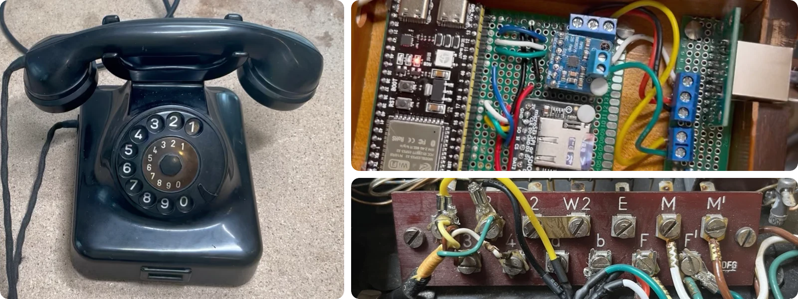
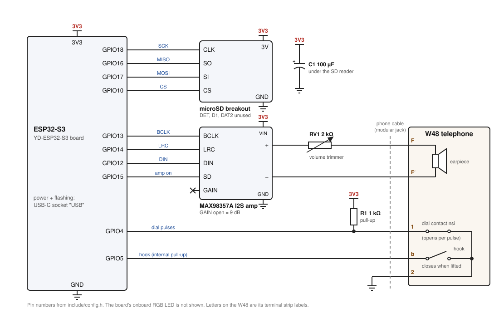

# jazzclub-phone

Firmware that turns a W48 rotary phone into a sample player, driven by an ESP32-S3 board.
Lift the handset, hear a dial tone, dial a number, and the phone "connects" to the sound
file named after that number.
Made with [Victor](https://www.instagram.com/victorbeysmith/) for
[Jazz Club](https://www.instagram.com/jazzclub/).

## Adding sounds

Put WAV files on the microSD card, named by the number that reaches them: `42.wav` is
reached by dialling 4, 2. Any number of digits works. Details, file format and the
optional looping `<number>.loop.wav` are in [docs/audio.md](docs/audio.md).

The easiest way, on macOS with `ffmpeg` and `sox` installed (`brew install ffmpeg sox`):

    tools/card.sh 42 my-recording.mp3     # convert and copy as 42.wav
    tools/card.sh ls                      # list what is on the card
    tools/card.sh eject                   # unmount before pulling the card

Then put the card back and power-cycle the board (or type `sd` in the serial monitor).
Without a card, the phone plays the files in its internal flash instead.

## Building and flashing

Needs [PlatformIO](https://platformio.org/install/cli) (CLI or the VS Code extension).
Use the USB-C socket marked "USB" (the one marked "COM" did not work in testing).

    pio run -t upload        # build and flash the firmware
    pio run -t uploadfs      # flash data/ into internal storage (replaces what is there)
    pio device monitor       # serial console, 115200 baud
    pio test -e native       # host-side unit tests, no board needed

## Serial console

With `pio device monitor` open, type `help`. Useful ones:

| Command | Does |
|---|---|
| `status` | hook and call state |
| `ls` | list the sound files the phone can see |
| `call <n>` | play the full call for number `<n>` without dialling |
| `play <n>` | play `<n>.wav` directly |
| `tone` / `busy` / `stop` | dial tone, busy tone, stop audio |
| `vol <0-100>` | software volume (the physical level is set by the trimmer on the board) |
| `lift` / `hangup` | simulate the handset |
| `test` | dial self-test: dial 0 through 9 in order |
| `raw` | print per-pulse timing, for diagnosing the dial |
| `sd` | re-mount the SD card and rescan |

## Configuration

- `include/config.h`: pins, dial timing, tones, call-setup sequence, LED.
- `include/directory.h`: number aliases (normally empty; numbers come from file names).

## Layout

- `src/`: board glue (GPIO, I2S audio, SD/flash, serial, LED)
- `lib/Phone/`: hardware-independent logic (pulse decoding, dialplan, call flow), unit-tested in `test/`
- `data/`: sounds for internal flash (two test sounds)
- `tools/`: audio conversion helpers

## Schematic

